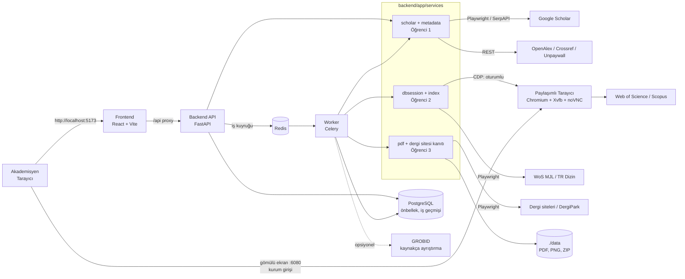

# Akademik Teşvik Başvuru Süreçlerinin Akıllı Otomasyonu
### Metin İşleme ve Görsel Kanıt Oluşturma — Proje Rehberi ve Görev Dağılımı

> Bu belge 4 proje öğrencisi için hazırlanmıştır. Önce **1–6. bölümleri herkes okusun**, sonra
> **8. bölümde** kendi görev listenize geçin. Görev listeleri **işlem önceliğine göre** sıralıdır;
> sırayı bozmayın, çünkü sonraki adımlar öncekilerin çıktısını kullanır.

---

## İçindekiler
1. [Uygulama ne yapacak?](#1-uygulama-ne-yapacak)
2. [Kılavuz analizi: sistemin uyması gereken kurallar](#2-kılavuz-analizi-sistemin-uyması-gereken-kurallar)
3. [Mimari](#3-mimari)
4. [Kullanılan teknolojiler ve kurulumlar (ne, neden)](#4-kullanılan-teknolojiler-ve-kurulumlar-ne-neden)
5. [Docker kullanımı](#5-docker-kullanımı)
6. [Modern ve güvenilir web scraping kuralları](#6-modern-ve-güvenilir-web-scraping-kuralları)
7. [Yol haritası ve ortak çalışma kuralları](#7-yol-haritası-ve-ortak-çalışma-kuralları)
8. [Görev dağılımı (4 öğrenci)](#8-görev-dağılımı)
9. [Entegrasyon, test ve teslim](#9-entegrasyon-test-ve-teslim)
10. [Riskler ve çözümleri](#10-riskler-ve-çözümleri)

---

## 1. Uygulama ne yapacak?

Akademisyen, akademik teşvik başvurusu için gereken **makale** ve **atıf** kanıt belgelerini,
Burdur Mehmet Akif Ersoy Üniversitesi *Akademik Teşvik Başvuru Sistemi Kılavuzu*'na
([kilavuz.pdf](kilavuz.pdf), Ocak/2024) uygun biçimde, **otomatik** hazırlar.

### Kullanıcı akışı (arayüz adımları)

| Adım | Ekran | Ne olur? |
|---|---|---|
| 1 | **Akademisyen** | Hoca ad-soyadını yazar → Google Scholar'da aranır. Aynı isimde birden fazla akademisyen varsa **fotoğraf, kurum, doğrulanmış e-posta alanı ve atıf sayısı** ile listelenir, hoca kendini seçer. Tek sonuç varsa bu adım otomatik geçilir. |
| 2 | **İşlem** | İki büyük seçenek: **"Makale belgelerini hazırla"** veya **"Atıf belgelerini hazırla"**. |
| 3 | **Yıl** | İki kart: *(bu yıl − 1) verileri → bu yıl başvurusu* ve *(bu yıl) verileri → gelecek yıl başvurusu*. Ocak–Mart arası önceki yıl, diğer aylarda içinde bulunulan yıl **"Önerilen"** olarak işaretlenir. Örn. Aralık 2026'da hazırlık yapan hoca **2026** verilerini (2027 başvurusu) seçer. |
| 4 | **WoS / Scopus girişi** | Sayfada **sistemin yönettiği gömülü bir tarayıcı** açılır (noVNC). Hoca "Giriş yap"a basar, tarayıcı WoS/Scopus giriş sayfasına gider; hoca **Institutional Sign In** bölümünden üniversitesini seçip kurum hesabıyla giriş yapar. Sistem erişimi sayfadan otomatik doğrular (yanılırsa hoca "Girişi yaptım" ile onaylar). **En az bir veri tabanında giriş doğrulanmadan dizin taraması ve kanıt üretimi başlamaz.** Şifre uygulamaya kaydedilmez; oturum yalnızca o tarayıcıda kalır. |
| 5 | **Sonuçlar** | Seçilen yıla ait kayıtlar listelenir; her biri **Kabul / Kontrol gerekli / Kabul edilmez** rozeti ve gerekçesiyle gösterilir. "Hazırlanacak belgeler" açılınca kılavuzdaki belge listesi görünür. |
| 6 | **Belgeleri hazırla** | Arka planda, giriş yapılan oturum kullanılarak WoS/Scopus atıf listeleri kılavuzdaki filtrelerle alınır, dizin kanıtları üretilir, PDF'ler indirilir, ilgili yerler **sarı işaretlenir**, kılavuzdaki **kırmızı açıklamalar** yazılır ve **her kayıt tek PDF** olarak birleştirilir. Otomatik yapılamayan bir adım olursa (site yapısı değişmiş vb.) sistem gömülü tarayıcıda o sayfayı açar, hocaya ne yapacağını madde madde söyler, hoca "Bu ekranı kanıt olarak kaydet"e basar. Hepsi ZIP olarak indirilir. |

**Yıl mantığının özeti:** X yılında yapılan yayın/atıflar için başvuru X+1 yılında yapılır.
- *Makalelerde*: yalnızca **basım (sayı) yılı = X** olan makaleler.
- *Atıflarda*: hocanın **eski yayınları dahil tüm yayınlarına**, **X yılında yayımlanmış** çalışmalarda yapılan atıflar.

---

## 2. Kılavuz analizi: sistemin uyması gereken kurallar

Bu kuralların kod karşılığı hazırdır: [backend/app/core/rules.py](backend/app/core/rules.py)
(testleri: [backend/tests/test_rules.py](backend/tests/test_rules.py)). Etiket metinleri kılavuzdaki kırmızı yazılarla birebir aynıdır.

### 2.1 Genel kurallar (kılavuz s.2)
- Belgelerin **yalnızca ilgili sayfaları** yüklenir (1500 sayfalık kitabın tamamı değil, ilgili sayfalar kesilir).
- Önemli yerler **boyanarak (sarı highlight) işaretlenir**, yanına kırmızı açıklama yazılır.
- Format dışı dosya iade edilir → çıktılar her zaman aynı düzende üretilmelidir.

### 2.2 MAKALE belgeleri (kılavuz s.3–7) — her makale için TEK PDF, bu sırayla

| Derginin dizini | 1. sayfa | 2. sayfa | 3+. sayfalar |
|---|---|---|---|
| **SCI / SCI-Expanded / SSCI / AHCI (ESCI)** | Makalenin ilk sayfası: **yayın yılı/tarihi** ve **başvuru sahibinin adı** işaretli (*"tarihin işaretlenmesi"*, *"ilgili yazarın işaretlenmesi"*) | **WoS Master Journal List** ekran görüntüsü, *"Science Citation Index Expanded"* (vb.) işaretli (*"sci indeksin işaretlenmesi"*) | Derginin *Editorial board* sayfası |
| **TR Dizin** | aynı | TR Dizin dergi kaydı ekran görüntüsü (yıl rozeti işaretli) | — |
| **Diğer uluslararası dizinler** (Scopus dahil) | aynı | Derginin **en az 5 yıldır** yayımlandığını gösteren kanıt (*"Founded: 2014"* vb.; arşivden de eklenebilir) | **Tarandığı dizinler** listesi + **editör/yayın kurulunun yabancı** olduğunu gösteren kısım (yabancı üye işaretli) |

### 2.3 ATIF belgeleri

Sistem iki yolu birlikte kullanır: WoS/Scopus'ta görünen atıflar **Yol B** ile (veri tabanı atıf listesi),
bu veri tabanlarında olmayan atıflar (ör. TR Dizin, diğer uluslararası dergiler) **Yol A** ile (doğrudan makale üzerinden) belgelenir.

**Yol A — "Atıfların doğrudan atıf yapan makaleler üzerinden gösterilmesi" (s.14–31).**
Her atıf için TEK PDF:

| Atıf yapan çalışma | Belgeler (sırasıyla) |
|---|---|
| **SCI/SCIE/SSCI dergide makale** | 1) Atıf yapan makalenin **kaynakça** sayfası — hocanın yayını işaretli (*"atıf veren makalenin kaynakça kısmında atıf verilen makalenin işaretlenmesi"*) 2) Atıf yapan makalenin **ilk sayfası** 3) Derginin SCI olduğunu gösteren **MJL** ekran görüntüsü (işaretli) |
| **TR Dizin dergide makale** | 1) Kaynakça (işaretli) 2) İlk sayfa 3) *"atıf veren TRdizin derginin indeksini gösteren belge"* |
| **Diğer uluslararası hakemli dergide makale** | 1) Kaynakça (işaretli) 2) İlk sayfa 3) *"atıf veren makalenin uluslararası index olduğunu gösteren belge"* (Indexing sayfası) 4) *5 yıldır yayın yaptığını gösteren belge ve editör/yayın kurulu* |
| **Uluslararası kitap / kitap bölümü** | 1) Kitabın kaynakça sayfası (işaretli) 2) Kitap bölümünün ilk sayfası 3) *"uluslararası kitap olduğunu gösteren belge"* (yayınevi sayfası, ISBN) → **Kontrol gerekli** olarak işaretlenir |

**Yol B — WoS / Scopus veri tabanı üzerinden (s.9–13)** — *hoca 4. adımda giriş yaptıktan sonra otomatik*.
Atıf alan **her yayın** için TEK PDF: 1) *başvuru sahibinin atıf alan çalışmasının ilk sayfası* 2) filtrelenmiş atıf listesinin
URL damgalı ekran görüntüsü (filtre satırı sarı işaretli). Kod: [rules.database_citation_plan](backend/app/core/rules.py),
[dbsession/wos.py](backend/app/services/dbsession/wos.py), [dbsession/scopus.py](backend/app/services/dbsession/scopus.py).

| Kılavuz şartı | Web of Science (sol panel filtreleri otomatik tıklanır) | Scopus (gelişmiş arama sorgusu olarak uygulanır) |
|---|---|---|
| Erken görünüm hariç (s.10 m.1, s.13 m.1) | Document Types → Early Access → **Exclude** | `PUBSTAGE(final)` |
| Bildiri içindeki atıflar hariç (proje kuralı) | Document Types → Proceedings Paper → **Exclude** | `DOCTYPE(ar OR re)` |
| Kendine atıf hariç (s.10 m.3, s.13 m.2) | Researcher Profiles → *Soyad, Ad* → **Exclude** | `NOT AU-ID(<yazar kimliği>)` |
| Dizin sınırlaması (s.10 m.4) | Web of Science Index → ör. SCI-Expanded → **Refine** | — |
| Yıl sınırlaması (s.10 m.5, s.13 m.3) | Publication Years → *yıl* → **Refine** | `PUBYEAR IS <yıl>` |
| Web adresi görünür (s.10 m.6, s.13 m.4) | Ekran görüntüsünün üstüne tam URL + tarih damgası | aynı |
| Scopus'taki atıfın başka dizinde olduğu ayrıca belgelenir (s.13 m.5) | — | İlgili atıf için Yol A dizin kanıtı eklenir |

Scopus'ta filtreler sorgu metni olarak sonuç sayfasında görünür (`REFEID(...) AND PUBYEAR IS 2026 AND PUBSTAGE(final) AND NOT AU-ID(...)`),
böylece ekran görüntüsü filtreleri kendiliğinden belgeler. Otomatik adım başarısız olursa sistem kullanıcıyı yönlendirir
(sayfayı açar + yapılacakları listeler), kullanıcı filtreleri elle uygulayıp ekranı kanıt olarak kaydeder; kaydedilen görüntüde
filtre ifadeleri OCR ile kontrol edilir ([rules.database_citation_checklist](backend/app/core/rules.py)).

### 2.4 Kabul / ret kuralları (atıflar)

| Durum | Karar | Kaynak |
|---|---|---|
| Atıf yapan çalışmanın yılı ≠ seçilen yıl | **Ret** | Yıl kuralı |
| Başvuru sahibi, atıf yapan çalışmanın yazarı (**kendine atıf**) | **Ret** | s.10 madde 3, s.13 madde 2 |
| Atıf **yapan** çalışma **bildiri** (konferans/kongre/sempozyum) — hocanın makalesine de bildirisine de | **Ret** | Proje kuralı |
| Hocanın **bildirisine**, bir dergi **makalesinde** yapılan atıf | **Kabul** | Proje kuralı |
| Atıf yapan çalışma **erken görünümde** (Early Access saat simgeli / Article in Press; cilt-sayı yok) | **Ret** | s.10 madde 1, s.13 madde 1 |
| "Early Access" ibareli ama sayıya girmiş (iki tarih var) | **Kabul** — basım yılı esas | s.11 madde 2 |
| Atıf yapan çalışma tez, preprint vb. | **Ret** | — |
| Kitap / kitap bölümü | **Kontrol gerekli** (uluslararası mı?) | s.21–23 |
| Tür veya dizin tespit edilemedi | **Kontrol gerekli** | — |
| Dergi makalesi + dizin tespit edildi | **Kabul** | — |

> **Bildiri kuralı (kesin):** Karar, atıfı **yapan** çalışmanın türüne göre verilir.
> - Hocanın çalışmasına (makale veya bildiri) gelen atıf bir **bildiri içinde** yapılmışsa → **kabul edilmez**.
> - Hocanın **bildirisine** bir **dergi makalesinde** yapılan atıf → **kabul edilir** (arayüzde "Atıf alan yayınınız bir bildiri;
>   atıf bir dergi makalesinden geldiği için kabul edilir" notu görünür).
>
> Atıf **alan** yayının türü kararı etkilemez. Kod: `evaluate_citation()` — [rules.py](backend/app/core/rules.py);
> testler: `test_article_citing_applicants_proceedings_accepted`, `test_proceedings_citing_applicants_proceedings_rejected`.
> Aynı kural Yol B'de de uygulanır (WoS: Proceedings Paper → Exclude, Scopus: `DOCTYPE(ar OR re)`).

### 2.5 Makale kabul kuralları
- Basım (sayı) yılı = seçilen yıl. Erken görünüm yılı farklıysa basım yılı esas alınır ve not düşülür.
- Cilt/sayı/sayfa bilgisi yoksa (henüz erken görünümde) → **Kontrol gerekli**.
- Bildiri, kitap vb. bu modülde hazırlanmaz → **Kontrol gerekli** (kılavuz s.32: proje/bildiri/sergi aynı mantıkla elle yüklenir).
- Dergi birden fazla dizindeyse en yüksek öncelikli olan kanıtlanır: SCIE > SSCI > AHCI > ESCI > Scopus > Diğer uluslararası > TR Dizin.

---

## 3. Mimari



### 3.1 Veri akışı
```
Ad Soyad ──► search_authors ──► [kullanıcı seçer] ──► Yıl seçimi ──► WoS/Scopus GİRİŞİ (gömülü tarayıcı)
                                                                      │  giriş doğrulanmadan aşağısı başlamaz
                                                     ┌────────────────┘
        ┌───────────── Makale ───────────────────────┴──────────── Atıf ─────────────────────┐
        │ list_publications → yıl filtresi            list_publications (TÜM yıllar)          │
        │ enrich_publication (OpenAlex/Crossref)      → list_citing_works(yayın, YIL)          │
        │ resolve_indexes (MJL/TR Dizin/…)            → enrich_citing_work (makale mi bildiri mi?)│
        │ evaluate_publication → evidence_plan        → resolve_indexes → evaluate_citation      │
        └──────────────────────────────┬──────────────────────────────────────────────────────┘
                                       ▼
          Her EvidenceItem: PDF indir + sayfa kes + highlight + kırmızı etiket (pdf)
                            veya ekran görüntüsü + highlight + URL damgası (evidence)
          Yol B: atıf alan her yayın için WoS/Scopus filtreli atıf listesi (oturumlu tarayıcı, dbsession)
                 otomatik olmazsa → kullanıcıya talimat + "Bu ekranı kanıt olarak kaydet"
                                       ▼
                    merge_pdfs → kayıt başına tek PDF → ZIP → arayüzden indir
```

### 3.2 Klasör yapısı ve sahiplik

```
.
├── docker-compose.yml          # tüm servisler (herkes; değişiklik PR ile)
├── .env.example                # ortam değişkenleri şablonu
├── kilavuz.pdf                 # MAKÜ kılavuzu (referans)
├── data/                       # üretilen dosyalar (git'e gitmez)
├── backend/
│   ├── Dockerfile, requirements.txt
│   ├── app/
│   │   ├── main.py, config.py, worker.py
│   │   ├── models/schemas.py   # ORTAK SÖZLEŞME (değişiklik = 4 onay)
│   │   ├── core/               # years.py, rules.py, names.py  (hazır; kural değişikliği ekipçe)
│   │   ├── api/                # REST uçları                    → Öğrenci 4
│   │   ├── pipeline/tasks.py   # Celery iş akışları             → Öğrenci 4
│   │   ├── services/scholar/   # Scholar sağlayıcıları          → Öğrenci 1
│   │   ├── services/metadata/  # OpenAlex/Crossref/Unpaywall    → Öğrenci 1
│   │   ├── services/dbsession/ # WoS/Scopus oturumu, atıf raporları → Öğrenci 2
│   │   ├── services/index/     # dizin tespiti (MJL, TR Dizin)     → Öğrenci 2
│   │   ├── services/evidence/  # web ekran görüntüsü + işaret      → Öğrenci 2 (ortak altyapı)
│   │   ├── services/journal/   # dergi sitesi: 5 yıl, dizin listesi, yayın kurulu → Öğrenci 3
│   │   ├── services/pdf/       # PDF işaretleme/birleştirme        → Öğrenci 3
│   │   └── fixtures/mock_data.json  # kurgusal örnek veri       → Öğrenci 4 bakımını yapar
│   ├── scripts/smoke_test.py   # kurulum doğrulama
│   ├── scripts/start_browser.sh # paylaşımlı tarayıcıyı başlatır (browser servisi)
│   └── tests/
└── frontend/                   # React arayüzü                  → Öğrenci 4
    ├── Dockerfile, package.json, vite.config.ts
    └── src/ (App.tsx, components/, lib/api.ts)
```

### 3.3 Şu an hazır olanlar
- Docker ortamı (7 servis), tüm kütüphane ve sistem kurulumları, kurulum doğrulama betiği.
- Ortak veri modelleri, yıl mantığı, kılavuz kuralları ve testleri (15 test geçiyor).
- **Mock modunda tam çalışan arayüz** (yazar arama → seçim → işlem → yıl → WoS/Scopus girişi → sonuç listesi). Mock verisindeki kişiler kurgusaldır.
- **WoS / Scopus girişi tam çalışır:** gömülü tarayıcı, giriş sayfasını açma, erişimi algılama (gerçek sitelerle test edildi),
  elle onay, oturumun Redis'te tutulması, giriş yapılmadan tarama/iş başlatılamaması (HTTP 409), ekranı kanıt olarak kaydetme.
- WoS/Scopus atıf raporu otomasyonunun ilk sürümü ([wos.py](backend/app/services/dbsession/wos.py),
  [scopus.py](backend/app/services/dbsession/scopus.py)). **Kurum hesabıyla doğrulanmadı** — seçicilerin gerçek oturumla
  test edilip düzeltilmesi Öğrenci 2'nin ilk işidir.
- Temel yardımcılar: PDF'te metin bulup sarı işaretleme + kırmızı etiket, sayfa kesme, PNG→PDF, birleştirme;
  web sayfasında metin işaretleme + URL/tarih damgalı ekran görüntüsü.
- `TODO(Öğrenci N)` yazan fonksiyonlar boş bırakılmıştır — görevleriniz bunlardır.

---

## 4. Kullanılan teknolojiler ve kurulumlar (ne, neden)

Hepsi Docker imajlarının içine kuruludur; bilgisayarınıza Python/Node kurmanız **gerekmez**.

### 4.1 Altyapı
| Bileşen | Sürüm | Nerede | Neden kuruldu |
|---|---|---|---|
| Docker + Docker Compose | Desktop güncel | Host | 4 kişinin birebir aynı ortamda çalışması; "bende çalışıyordu" sorununu ortadan kaldırır. |
| PostgreSQL | 16 | `db` servisi | Scholar/dizin sorgu **önbelleği** (aynı sayfayı tekrar çekmemek = engellenmemek), iş geçmişi, sonuçlar. |
| Redis | 7 | `redis` servisi | Celery iş kuyruğu ve iş durumu (ilerleme yüzdesi). |
| **Paylaşımlı tarayıcı** | Chromium 131 | `browser` servisi | Kullanıcının WoS/Scopus'a **kurum hesabıyla** girdiği, arayüzde gömülü görünen tarayıcı. Worker aynı oturumu CDP ile kullanır; şifre uygulamaya hiç gelmez. Oturum `browser-profile` volume'ünde kalıcıdır. |
| GROBID (opsiyonel) | 0.8.1 | `grobid` profili | Zor PDF'lerde kaynakça girdilerini koordinatlarıyla ayrıştırır; Öğrenci 3'ün yedek yöntemi. |

### 4.2 Backend (Python 3.12) — [backend/requirements.txt](backend/requirements.txt)
| Paket | Amaç |
|---|---|
| **FastAPI, Uvicorn, Pydantic, pydantic-settings** | REST API, otomatik dokümantasyon (`/docs`), tip güvenli veri modelleri, `.env` okuma. |
| **python-multipart** | Paywall'lı makalelerin PDF'ini veya WoS/Scopus raporunu kullanıcının yüklemesi. |
| **Celery + redis** | Dakikalar sürebilen tarama/PDF üretimini arka planda çalıştırmak; arayüz donmaz. |
| **SQLAlchemy, psycopg, Alembic** | Veritabanı erişimi ve şema göçleri (önbellek tablosu vb.). |
| **Playwright + Chromium** | JavaScript ile yüklenen sitelerin (Scholar, WoS MJL, TR Dizin, dergi siteleri) gerçek tarayıcıyla açılması, sayfada metnin **sarı işaretlenmesi** ve **ekran görüntüsü** alınması. |
| **httpx + tenacity** | OpenAlex, Crossref, Unpaywall, SerpAPI, Elsevier REST çağrıları; hata durumunda üstel bekleme ile yeniden deneme. |
| **curl_cffi** | Tarayıcı açmaya gerek olmayan statik sayfalarda (ör. DergiPark) gerçek tarayıcı TLS parmak izi ile hafif istek. |
| **BeautifulSoup4 + lxml** | HTML ayrıştırma (yazar kartları, dizin listeleri, yayın kurulu). |
| **PyMuPDF** | PDF'te metin arama (koordinatlarıyla), **highlight annotation**, kırmızı açıklama yazma, sayfa kesme, birleştirme. Projenin PDF çekirdeği. |
| **pypdf** | Yardımcı PDF işlemleri (bozuk PDF onarma, metadata). |
| **img2pdf** | Ekran görüntüsünü kayıpsız PDF sayfasına çevirme. |
| **ocrmypdf + pytesseract** | Taranmış (resim) PDF'lere metin katmanı ekleme; WoS/Scopus ekran görüntülerinde filtre ifadelerini okuma. |
| **Pillow** | Ekran görüntüsünün üstüne **URL + tarih + kırmızı açıklama** şeridi (kılavuz: "web adresi belge üzerinde görülebilmelidir"). |
| **rapidfuzz + unidecode** | Kaynakçada başlık için bulanık eşleştirme; "Gürsoy, O." = "Oğuz Gürsoy" gibi isim eşleştirme (kendine atıf tespiti). |
| **pytest, ruff** | Birim testler ve kod stili denetimi. |

### 4.3 Sistem paketleri (backend imajı)
| Paket | Amaç |
|---|---|
| `tesseract-ocr`, `tesseract-ocr-tur`, `tesseract-ocr-eng` | Türkçe + İngilizce OCR. |
| `ghostscript` | ocrmypdf'nin PDF optimizasyon adımları. |
| `fonts-dejavu-core` | PDF/ekran görüntüsüne **Türkçe karakterli** (ı, ş, ğ) etiket yazmak. |
| Chromium + bağımlılıkları | `playwright install --with-deps chromium` ile. |
| `xvfb` | Sanal ekran: Chromium'u görünür (pencereli) çalıştırmak için. |
| `x11vnc` | Sanal ekranı VNC olarak yayınlar. |
| `novnc`, `websockify` | VNC'yi web sayfasına çevirir → arayüzde gömülü tarayıcı (http://localhost:6080). |
| `socat` | Chromium'un yalnızca kendi içine açık uzaktan kontrol (CDP) portunu diğer container'lara iletir. |
| `fonts-noto-core` | Gömülü tarayıcıda sitelerin Türkçe/uluslararası karakterlerle düzgün görünmesi. |

### 4.4 Frontend — [frontend/package.json](frontend/package.json)
| Paket | Amaç |
|---|---|
| **React 18 + TypeScript** | Bileşen tabanlı, tip güvenli arayüz. |
| **Vite** | Hızlı geliştirme sunucusu; `/api` isteklerini backend'e yönlendirir (CORS gerekmez). |
| **Tailwind CSS** | Hızlı, tutarlı, sade görsel tasarım (MAKÜ moru `maku-*` renkleri tanımlı). |
| **TanStack Query** | API çağrıları, yükleniyor/hata durumları, iş ilerlemesini periyodik sorgulama. |
| **lucide-react** | İkonlar. |

### 4.5 Dış veri kaynakları
| Kaynak | Erişim | Ne için |
|---|---|---|
| Google Scholar | Playwright veya SerpAPI | Yazar arama (foto, kurum), yayın listesi, "Cited by" + yıl filtresi (`as_ylo/as_yhi`). |
| **OpenAlex** (ücretsiz API) | REST | Yayın türü (makale/bildiri), ISSN, cilt/sayı, atıf doğrulama (`filter=cites:W…,publication_year:YIL`), açık erişim PDF. |
| **Crossref** (ücretsiz API) | REST | DOI ile tür (`journal-article` / `proceedings-article`), basım vs. online yılı. |
| **Unpaywall** (ücretsiz API) | REST | Açık erişim PDF bağlantısı. |
| **Web of Science** (kurum girişi) | Paylaşımlı tarayıcı + CDP | Filtreli atıf listesi (kılavuz s.10–11), dizin bilgisi. |
| **Scopus** (kurum girişi) | Paylaşımlı tarayıcı + CDP | Filtreli atıf listesi (s.12–13), derginin Scopus kapsamı. |
| WoS Master Journal List | Playwright | SCIE/SSCI/AHCI/ESCI kanıtı (kılavuz s.5). |
| TR Dizin | Playwright | TR Dizin kanıtı (kılavuz s.20). |
| Dergi siteleri / DergiPark | Playwright / curl_cffi | Dizin listesi, kuruluş yılı, yayın kurulu. |

---

## 5. Docker kullanımı

### 5.1 İlk kurulum (herkes, bir kez)
Ön koşul: **Docker Desktop** (Windows'ta WSL2 açık, Settings → Resources → en az **6–8 GB RAM**) ve **Git**.

```bash
# 1) Repoyu klonla
git clone https://github.com/furkanatlan/Akademik-Tesvik-Basvuru-Sureclerinin-Akilli-Otomasyonu.git
cd Akademik-Tesvik-Basvuru-Sureclerinin-Akilli-Otomasyonu

# 2) Ortam dosyasını oluştur (Windows PowerShell: copy .env.example .env)
cp .env.example .env
#    .env içinde CONTACT_EMAIL'i kendi üniversite e-postanla değiştir.

# 3) İmajları derle ve tüm servisleri başlat (ilk sefer 5-10 dk sürer)
docker compose up -d --build

# 4) Kurulumu doğrula — tüm satırlar "OK" olmalı
docker compose exec backend python scripts/smoke_test.py

# 5) Testleri çalıştır
docker compose exec backend pytest -q
```

Sonra tarayıcıda:
- **Uygulama:** http://localhost:5173  (mock modda "Ahmet Yılmaz" arayarak akışı deneyin; mock modda WoS/Scopus girişi atlanabilir)
- **Gömülü tarayıcı (doğrudan):** http://localhost:6080/vnc.html?autoconnect=1  (arayüz bunu 4. adımda zaten gösterir)
- **API dokümantasyonu (Swagger):** http://localhost:8000/docs
- Üretilen dosyalar: projedeki `data/` klasörü (smoke test çıktıları `data/smoke/`)

> Git Bash kullanıyorsanız ve `docker compose exec` komutlarında yol hatası alırsanız komutun başına
> `MSYS_NO_PATHCONV=1 ` ekleyin ya da PowerShell kullanın.

### 5.2 Her çalışma gününde TEKRARLANACAKLAR
```bash
git checkout main && git pull                 # 1) güncel kodu al
git checkout -b ogrenci1/yazar-arama          # 2) (yeni iş ise) kendi dalını aç / mevcut dalına geç: git checkout <dal>
git merge main                                 #    mevcut dalındaysan main'deki yenilikleri al
docker compose up -d                           # 3) servisleri başlat (kod değişikliği için tekrar build GEREKMEZ)
docker compose logs -f backend worker          # 4) (gerekirse) logları izle, Ctrl+C ile çık
# ... kod yaz ... backend kodu kaydedince API otomatik yeniden başlar, arayüz otomatik yenilenir
docker compose restart worker                  # 5) worker'ın kullandığı kodu değiştirdiysen (worker otomatik yenilenmez)
docker compose exec backend pytest -q          # 6) testler
docker compose exec backend ruff check .       # 7) stil denetimi
docker compose exec frontend npm run typecheck # 8) (frontend değiştiyse) tip denetimi
git add -A && git commit -m "Öğrenci1: yazar arama Playwright"   # 9) commit
git push -u origin <dal-adı>                   # 10) push → GitHub'da Pull Request aç
docker compose stop                            # 11) gün sonunda (veriler korunur)
```

### 5.3 Ne zaman ne yapmalı? (komut tablosu)

| Durum | Komut |
|---|---|
| `backend/requirements.txt` değişti (siz ya da arkadaşınız paket ekledi) | `docker compose build backend worker && docker compose up -d` |
| `frontend/package.json` değişti | `docker compose build frontend && docker compose up -d --renew-anon-volumes frontend` |
| `.env` değişti (ör. `SCHOLAR_PROVIDER=playwright`) | `docker compose up -d --force-recreate backend worker` |
| `docker-compose.yml` değişti | `docker compose up -d` |
| Container içinde komut satırı | `docker compose exec backend bash` |
| Python denemesi (ör. bir fonksiyonu elle çağırmak) | `docker compose exec backend python -c "from app.core.years import year_options; print(year_options())"` |
| Veritabanına bağlanmak | `docker compose exec db psql -U tesvik` |
| Gömülü tarayıcı açılmıyor / donmuş | `docker compose restart browser` (oturum çerezleri korunur) |
| WoS/Scopus oturumunu tamamen silmek | `docker compose stop browser && docker compose rm -f browser && docker volume rm akademik-tesvik_browser-profile && docker compose up -d browser` |
| WoS/Scopus girişini zorunlu olmaktan çıkarmak (yalnızca geliştirme) | `.env` → `REQUIRE_DB_LOGIN=false` → `docker compose up -d --force-recreate backend worker` |
| GROBID'i açmak (Öğrenci 3, gerekirse) | `docker compose --profile grobid up -d grobid` → http://localhost:8070 |
| Servislerin durumu | `docker compose ps` |
| Her şeyi durdurup silmek (DB verisi KALIR) | `docker compose down` |
| DB dahil sıfırlamak | `docker compose down -v` |
| Yeni paket eklemek (backend) | `requirements.txt`'ye **sürümüyle** ekle → yukarıdaki build komutu → PR'da belirt |
| Yeni paket eklemek (frontend) | `docker compose exec frontend npm install <paket>@<sürüm>` → `package.json` + `package-lock.json` commit |

### 5.4 Sık sorunlar
| Belirti | Çözüm |
|---|---|
| Arayüzde gömülü tarayıcı alanı siyah/boş | `docker compose ps` ile `browser` servisini kontrol edin; http://localhost:6080/vnc.html adresini doğrudan açmayı deneyin. |
| `port is already allocated` (8000/5173/6080) | O portu kullanan programı kapatın veya `docker-compose.yml`'de sol taraftaki portu değiştirin (ör. `"8001:8000"`). Postgres/Redis dışarı açılmadığı için çakışmaz. |
| Kod değişikliği API'ye yansımıyor | `docker compose restart backend` (worker için `restart worker`). |
| Arayüz değişikliği yansımıyor | Tarayıcıda Ctrl+F5; olmazsa `docker compose restart frontend`. |
| `ModuleNotFoundError` | Biri `requirements.txt` değiştirmiştir → `docker compose build backend worker`. |
| Chromium çöküyor | Docker Desktop RAM'ini artırın (`shm_size` zaten 1 GB). |
| `.sh`/Python dosyalarında `\r` hataları | Repo `.gitattributes` ile LF kullanır; `git config --global core.autocrlf input` yapıp yeniden klonlayın. |

---

## 6. Modern ve güvenilir web scraping kuralları

Bu kurallar **Öğrenci 1 ve Öğrenci 2 için zorunludur.**

1. **Önce API, sonra resmi liste, en son tarayıcı.** OpenAlex/Crossref/Unpaywall/Elsevier API'leri ücretsiz ve kararlıdır; HTML kazımaya yalnızca API'de olmayan bilgi için (Scholar profil, MJL, TR Dizin, dergi sayfası) başvurun.
2. **Polite pool:** OpenAlex/Crossref/Unpaywall isteklerine `mailto=CONTACT_EMAIL` ekleyin.
3. **Önbellek zorunlu:** Her dış istek önce Postgres önbelleğine bakar (`CACHE_TTL_HOURS`). Geliştirme sırasında aynı sayfayı 50 kez çekmek = IP engeli.
4. **Hız sınırı:** Scholar ve dergi sitelerinde istekler arası `SCRAPE_MIN_DELAY_SEC`–`SCRAPE_MAX_DELAY_SEC` rastgele bekleme; **paralel istek yok**.
5. **Gerçekçi tarayıcı bağlamı:** Tek kalıcı Playwright context, güncel User-Agent, `tr-TR` locale, 1366×900 viewport; çerez bannerlarını kapatın.
6. **Sabit `sleep` yerine akıllı bekleme:** `page.wait_for_selector(...)`, `wait_until="networkidle"`.
7. **Yeniden deneme:** `tenacity` ile üstel bekleme (ör. 3 deneme, 2–30 sn); 429/503'te bekleyip tekrar.
8. **CAPTCHA'yı atlatmaya çalışmayın:** `gs_captcha` / "unusual traffic" görülürse işi durdurun, kullanıcıya bildirin ve SerpAPI'ye geçin (fallback).
9. **Seçicileri tek yerde tutun:** Her site için CSS seçicileri modülün başında sabit olarak; site değişince tek yer düzeltilir.
10. **Kayıtlı HTML ile test:** Testler canlı siteye gitmez; `tests/fixtures/html/` altına kaydedilmiş örnek sayfalar üzerinde çalışır.
11. **Hata ayıklama izi:** Başarısız taramada HTML ve ekran görüntüsünü `data/debug/` altına kaydedin.
12. **Kişisel veri:** Testlerde gerçek hocaların verisini repoya koymayın; mock veri kurgusaldır.

---

## 7. Yol haritası ve ortak çalışma kuralları

### 7.1 Yol haritası (8 hafta)

| Faz | Hafta | Öğrenci 1 (Veri) | Öğrenci 2 (Dizin/Web kanıt) | Öğrenci 3 (PDF) | Öğrenci 4 (Arayüz/API/Akış) | Kilometre taşı |
|---|---|---|---|---|---|---|
| 0 | 1 | Kurulum, kılavuz okuma | Kurulum, kılavuz okuma, gömülü tarayıcıyı deneme | Kurulum, kılavuz okuma | Kurulum, kılavuz okuma, mock arayüz | Herkeste smoke test OK |
| 1 | 2–3 | Önbellek + hız sınırlayıcı, yazar arama, yayın listesi | Gerçek kurum girişiyle oturum algılama, **Scopus** atıf raporu | PDF indirme, ilk sayfa işaretleme | Arayüz iyileştirme, dosya uçları, iş akışı iskeleti | **M1:** Gerçek yazar arama + doğrulanmış WoS/Scopus girişi |
| 2 | 4–5 | OpenAlex/Crossref zenginleştirme | **WoS** atıf raporu, yönlendirmeli yedek yol, MJL | OCR, kaynakçada atıf bulma | **Makale** iş akışı, yönlendirmeli adım arayüzü | **M2:** Gerçek makale → tek PDF; WoS/Scopus atıf listesi görüntüsü |
| 3 | 6–7 | Yıla göre atıf toplama, makale/bildiri sınıflandırma | Scopus dergi kapsamı, TR Dizin, `resolve_indexes` | Dergi sitesi kanıtları, birleştirme, ZIP | **Atıf** iş akışı (Yol A + B), elle yükleme, manuel düzeltme | **M3:** Gerçek atıflar → tek PDF'ler |
| 4 | 8 | Hata düzeltme | Hata düzeltme | Hata düzeltme | E2E test, demo | **M4:** 3 gönüllü hocayla gerçek deneme, rapor |

### 7.2 Ortak kurallar
- **Dal (branch) adı:** `ogrenciN/kisa-konu` (ör. `ogrenci2/mjl`). `main`'e doğrudan push yok; **Pull Request** + en az 1 arkadaş onayı.
- **Ortak sözleşme:** [schemas.py](backend/app/models/schemas.py) değişikliği ayrı bir PR'da yapılır ve **4 kişinin onayı** gerekir. Frontend'deki [api.ts](frontend/src/lib/api.ts) tipleri aynı PR'da güncellenir.
- **Kural değişikliği:** [rules.py](backend/app/core/rules.py) ve [years.py](backend/app/core/years.py) kılavuzla ilgilidir; değişiklik test eklenmeden birleştirilmez.
- **Herkes kendi klasöründe çalışır** (3.2'deki sahiplik); başkasının modülünde değişiklik gerekiyorsa o kişiye issue açın.
- **Mock-first:** Bir modül bitene kadar diğerleri mock veriyle çalışır; kimse kimseyi beklemez.
- **Testsiz PR yok:** Her yeni fonksiyon için en az bir `pytest` testi.
- **Haftalık toplantı:** Kilometre taşlarını gözden geçirin; engel varsa GitHub Issues'a yazın.

---

## 8. Görev dağılımı

Her öğrencinin listesi **Adım 0**'dan başlar ve sırayla ilerler. Her adımın sonunda **"Kontrol"** satırındaki
komut başarılı olmadan sonraki adıma geçmeyin. Her adım bitince 5.2'deki günlük döngüyle commit/PR yapın.

---

### 👤 Öğrenci 1 — Veri Toplama: Google Scholar + Metadata Zenginleştirme
**Sorumluluk:** Hocayı bulmak, yayınlarını ve seçilen yıldaki atıflarını toplamak; her kaydın **türünü (makale/bildiri)**,
yılını, cilt/sayısını, ISSN'ini ve PDF bağlantısını güvenilir kaynaklardan doğrulamak.
**Dosyalar:** `backend/app/services/scholar/*`, `backend/app/services/metadata/*`, `backend/app/services/cache.py` (yeni), `backend/tests/test_scholar_*.py`
**Teknolojiler:** Playwright (Python), httpx, tenacity, BeautifulSoup/lxml, OpenAlex/Crossref/Unpaywall API, SerpAPI, SQLAlchemy, rapidfuzz.

0. **Ortak kurulum** (5.1). Kılavuz s.1–2 ve s.8–31'i okuyun. [base.py](backend/app/services/scholar/base.py), [mock_provider.py](backend/app/services/scholar/mock_provider.py) ve [schemas.py](backend/app/models/schemas.py)'ı inceleyin.
   *Kontrol:* `docker compose exec backend python scripts/smoke_test.py` → tümü OK.
1. **Önbellek + hız sınırlayıcı** (`services/cache.py`): Postgres'te `http_cache(key, url, body, fetched_at)` tablosu (SQLAlchemy + Alembic göçü); `cached_get(url)` ve `polite_delay()` fonksiyonları. *Öğrenci 2 ve 3 de bunu kullanacağı için ilk iş budur.*
   *Kontrol:* aynı URL iki kez istendiğinde ikincisi DB'den gelir (test).
2. **Yazar arama — Playwright** (`playwright_provider.search_authors`): `view_op=search_authors` sayfasından **ad, kurum, doğrulanmış e-posta alanı, fotoğraf URL'si, toplam atıf, ilgi alanları**. CAPTCHA tespiti → `ScholarBlockedError`.
   *Kontrol:* `.env`'de `SCHOLAR_PROVIDER=playwright` → `docker compose up -d --force-recreate backend worker` → arayüzde gerçek bir isim arayın; aynı isimli kişiler fotoğraf ve kurumuyla listelenmeli.
3. **SerpAPI sağlayıcısı + otomatik yedek:** `serpapi_provider.py` üç fonksiyon; Playwright `ScholarBlockedError` verirse ve `SERPAPI_KEY` varsa SerpAPI'ye geçiş (`get_provider` içinde).
   *Kontrol:* `SCHOLAR_PROVIDER=serpapi` ile aynı arama aynı sonucu verir.
4. **Yayın listesi** (`list_publications`): sayfalama (`cstart`, `pagesize=100`), başlık, yazarlar, dergi, yıl, `cites_id`/cited_by bağlantısı.
   *Kontrol:* Swagger'da `/api/authors/{id}/publications?year=...` doğru yılın yayınlarını döndürür.
5. **Yayın zenginleştirme** (`metadata/enrich.py → enrich_publication`): OpenAlex `search` + Crossref ile **DOI, work_type, ISSN/eISSN, volume/issue/pages, basım yılı (`published-print`) ve online yılı, publisher, homepage, pdf_url** (Unpaywall/OpenAlex `best_oa_location`). Eşleşme ölçütü: `rapidfuzz.token_set_ratio ≥ 92` ve yıl farkı ≤ 1.
   *Kontrol:* erken görünümü önceki yıl, basımı bu yıl olan bir makale doğru yılda listelenir ve gerekçede not görünür.
6. **Yıla göre atıf toplama** (`list_citing_works(pub, year)`): Scholar `cites=<id>&as_ylo=YIL&as_yhi=YIL` (tüm sayfalar) + OpenAlex `filter=cites:<W>,publication_year:YIL` ile çapraz kontrol; DOI/başlığa göre tekilleştirme. **Eski yayınlar dahil tüm yayınlar** taranır.
   *Kontrol:* 2015 yayınına 2026'da yapılan atıf, 2026 seçildiğinde listelenir; 2025 atıfı listelenmez.
7. **Makale/bildiri sınıflandırma** (`enrich_citing_work`) — *projenin en kritik kuralı*:
   Crossref `proceedings-article` veya OpenAlex `source.type = conference` veya kaynak adında *Proceedings, Conference, Symposium, Congress, Workshop, Kongre, Sempozyum, Bildiri* → `PROCEEDINGS`; `book-chapter`/`book` → `BOOK_CHAPTER`/`BOOK`; belirlenemezse `UNKNOWN` (arayüzde "Kontrol gerekli"). Ayrıca yazar listesini eksiksiz doldurun (kendine atıf tespiti buna bağlı).
   *Kontrol:* bildiri içindeki atıf arayüzde "Kabul edilmez – bildiri" gerekçesiyle görünür.
8. **Testler:** `tests/fixtures/html/scholar_*.html` kayıtlı sayfalarla ayrıştırıcı testleri; OpenAlex/Crossref yanıt örnekleri JSON olarak. Canlı istek atan test yok.
   *Kontrol:* `docker compose exec backend pytest -q` yeşil.

**Teslim ölçütü:** Gerçek bir hoca için yazar seçimi, yıl filtreli yayın listesi ve yıl filtreli atıf listesi (türleri doğru) arayüzde görünür.
**Bağımlılık:** Kimseyi beklemez. Çıktısını Öğrenci 2 (DOI, ISSN), Öğrenci 3 (pdf_url, başlık, homepage) ve Öğrenci 4 kullanır.

---

### 👤 Öğrenci 2 — WoS / Scopus Oturumlu Tarama ve Dizin Kanıtları
**Sorumluluk:** Hocanın gömülü tarayıcıda açtığı **WoS / Scopus oturumunu** kullanarak kılavuzdaki filtrelerle atıf listelerini
(Yol B) almak; dergilerin hangi dizinde tarandığını (WoS MJL, Scopus, TR Dizin) bulup **işaretli + URL damgalı** kanıt üretmek.
**Dosyalar:** `backend/app/services/dbsession/*` (`browser.py`, `wos.py`, `scopus.py`), `backend/app/services/index/*`,
`backend/app/services/evidence/*`, `backend/scripts/start_browser.sh`, `backend/tests/test_dbsession*.py`, `backend/tests/test_index_*.py`
**Teknolojiler:** Playwright (`connect_over_cdp` ile oturumlu tarayıcı; headless Chromium ile açık siteler), noVNC/Xvfb (browser servisi),
Redis (oturum durumu), Pillow, BeautifulSoup.

0. **Ortak kurulum** (5.1). Kılavuz s.4–5, 9–13, 17, 20'yi okuyun. [browser.py](backend/app/services/dbsession/browser.py),
   [wos.py](backend/app/services/dbsession/wos.py), [scopus.py](backend/app/services/dbsession/scopus.py) ve
   [screenshot.py](backend/app/services/evidence/screenshot.py) dosyalarını inceleyin.
   *Kontrol:* smoke test'te "Paylaşımlı tarayıcı … CDP bağlantısı" satırı OK; http://localhost:6080/vnc.html açılıyor.
1. **Gerçek kurum hesabıyla giriş akışını doğrulayın** (kampüs ağı veya MAKÜ kurum girişi; hesabı danışman/gönüllü hoca sağlar):
   arayüzde 4. adımda WoS ve Scopus için *Giriş yap → kurum girişi → Girişi kontrol et*. Otomatik algılama yanlış sonuç verirse
   `DATABASES` içindeki `denied_patterns` / `granted_patterns` listelerini düzeltin. Giriş yapılmadan
   `GET /api/authors/{id}/citations` çağrısının **409** döndüğünü doğrulayın (`.env`: `SCHOLAR_PROVIDER` mock dışında bir değer).
   *Kontrol:* iki veri tabanında da "Erişim doğrulandı." mesajı.
2. **Scopus atıf raporu** (`scopus.citing_report`): kılavuz s.13'teki örnek yayın ve kendi test yayınınızla çalıştırın.
   EID bulma (`DOI(...)`), yazar kimliği bulma (`authorId=`), sorgu
   `REFEID(...) AND PUBYEAR IS <yıl> AND PUBSTAGE(final) AND DOCTYPE(ar OR re) AND NOT AU-ID(...)`.
   Sonuç sayısı ayrıştırma ve işaretlemenin çalıştığını görün; seçicileri düzeltin. Deneme için küçük bir betik yazın
   (`scripts/try_scopus.py`: `shared_context()` içinde `citing_report(...)` çağırır) ve
   `docker compose exec backend python scripts/try_scopus.py` ile çalıştırın.
   *Kontrol:* `data/` altındaki görüntü kılavuz s.13 görünümüne benzer.
3. **WoS atıf raporu** (`wos.citing_report`): advanced search → kayıt → *Citations* → sol panelde sırayla Early Access **Exclude**,
   Proceedings Paper **Exclude**, Researcher Profiles **Exclude**, Web of Science Index **Refine**, Publication Years **Refine**.
   Seçicileri (`RECORD_TITLE`, `CITING_LINK`, `_facet`) gerçek sayfaya göre düzeltin. Sayfa başındaki
   `Refined By: … NOT Document Types: Early Access … NOT Researcher Profiles: …` satırı görüntüde olmalı (kılavuz s.11).
   *Kontrol:* kılavuz s.11'deki görünüme benzeyen işaretli, URL damgalı görüntü.
4. **Yönlendirmeli yedek yol:** 2–3'te bir adım başarısız olunca `GuidedStepRequired` doğru talimatlarla fırlatılsın; kullanıcı aynı
   tarayıcıda adımı tamamlayınca `POST /api/db-session/{db}/capture` ekranı kaydeder. Kaydedilen görüntüde
   `rules.database_citation_checklist()` ifadelerini OCR ile kontrol eden fonksiyonu yazın (`dbsession/validate.py`).
5. **Oturum sağlığı:** iş başlamadan önce `check_login()` ile oturumun hâlâ geçerli olduğunu doğrulayan `ensure_fresh_session(db)`
   (süre dolmuşsa "tekrar giriş yapın" uyarısı). Tarayıcı yeniden başlatıldığında oturumun korunduğunu test edin.
6. **WoS Master Journal List** (`index/mjl.py`): ISSN ile arama, "Web of Science Core Collection" alanından SCIE/SSCI/AHCI/ESCI tespiti,
   ifadenin **sarı işaretli** ekran görüntüsü + etiket *"… indeksi gösteren belge – indeksin işaretlenmesi"* (kılavuz s.5, s.17).
   *Kontrol:* "Energy Conversion and Management" (ISSN 0196-8904) → `SCIE` ve işaretli görüntü.
7. **Scopus dergi kapsamı** (`scopus.journal_coverage`): oturumlu tarayıcıda ISSN → kaynak sayfası → işaretli görüntü. Scopus listesindeki bir
   atıfın WoS/başka dizinde olduğunun ayrıca belgelenmesi (s.13 m.5) için Öğrenci 3'ün dergi sitesi kanıtıyla birleştirin.
8. **TR Dizin** (`index/trdizin.py`): dergi adı/ISSN ile arama, taranan yıllar (yeşil yıl rozetleri), işaretli görüntü (kılavuz s.20).
9. **`resolve_indexes` birleşimi:** MJL → Scopus → TR Dizin (+ Öğrenci 3'ün dergi sitesi sonucu) sırasıyla, önbellekli;
   `JournalInfo.indexes`, `index_evidence_urls` doldurulur. `capture_evidence(item, out_dir) -> Path` fonksiyonu
   `INDEX_SCREENSHOT` ve `DATABASE_CITATION_REPORT` türlerini üretir (Öğrenci 4 akışta çağırır).
10. **Testler:** kayıtlı HTML'lerle (`tests/fixtures/html/wos_*.html`, `scopus_*.html`, `mjl_*.html`, `trdizin_*.html`) ayrıştırıcı ve
    erişim algılama testleri. Gerçek hesap bilgisi veya oturum çerezi **asla** repoya konmaz.

**Teslim ölçütü:** Giriş yapılmış oturumla, bir yayın için kılavuz s.11 ve s.13'teki görünüme denk WoS ve Scopus atıf listesi görüntüleri
ve SCIE / Scopus / TR Dizin dergiler için işaretli dizin kanıtları otomatik üretilir.
**Bağımlılık:** DOI/ISSN için Öğrenci 1 (hazır olana kadar elle verin). Çıktısını Öğrenci 3 (PNG→PDF) ve Öğrenci 4 kullanır.

---

### 👤 Öğrenci 3 — PDF İşleme ve Dergi Web Sitesi Kanıtları
**Sorumluluk:** Makale PDF'lerini indirmek; ilk sayfada **yılı ve hocanın adını**, atıf yapan makalenin **kaynakçasında hocanın yayınını**
bulup sarı işaretlemek; kılavuzdaki kırmızı açıklamaları yazmak; WoS/Scopus dışındaki dergiler için **dergi sitesinden** 5 yıl,
dizin listesi ve yabancı yayın kurulu kanıtlarını üretmek; yalnızca ilgili sayfaları kesip **kayıt başına tek PDF** ve ZIP üretmek.
**Dosyalar:** `backend/app/services/pdf/*` (`fetch.py`, `ocr.py`, `highlight.py`, `references.py`, `assemble.py`),
`backend/app/services/journal/*` (`site.py`), `backend/tests/test_pdf_*.py`, `backend/tests/test_journal_*.py`, `backend/tests/fixtures/pdf/`
**Teknolojiler:** PyMuPDF, ocrmypdf + Tesseract (tur+eng), img2pdf, rapidfuzz, unidecode, httpx/Playwright, curl_cffi, BeautifulSoup, GROBID (opsiyonel).

0. **Ortak kurulum** (5.1). Kılavuz s.2, 4, 6–7, 15–16, 18–19, 21–31'i okuyun. `data/smoke/pdf_highlight.pdf` ve `birlesik_ornek.pdf`'yi açın;
   [highlight.py](backend/app/services/pdf/highlight.py), [assemble.py](backend/app/services/pdf/assemble.py),
   [journal/site.py](backend/app/services/journal/site.py) dosyalarını inceleyin.
   *Kontrol:* smoke test OK.
1. **Test PDF seti:** `tests/fixtures/pdf/` altına 5–6 **açık erişimli** makale (Elsevier/Springer/DergiPark/IEEE farklı düzenler) + 1 taranmış (resim) PDF.
2. **PDF indirme** (`fetch.py → download_pdf(url, dst)`): httpx, `%PDF` imza kontrolü; yayıncı yönlendirmelerinde Playwright `expect_download()`.
   Abonelik gerektiren PDF'ler için **oturumlu paylaşımlı tarayıcıyı** (`dbsession.browser.shared_context`) kullanarak kurum erişimiyle indirme;
   o da olmazsa `PdfUnavailableError` (arayüz "PDF'i elle yükleyin" der).
   *Kontrol:* OA bir DOI'nin `pdf_url`'sinden PDF iner.
3. **Metin katmanı + OCR** (`ocr.py → ensure_text_layer(pdf)`): metin yoksa `ocrmypdf --language tur+eng --skip-text`.
4. **İlk sayfa işleme** (`process_first_page(pdf, year, author_name) -> Path`): üst bölgedeki **yayın yılını** ve yazar bloğundaki **hocanın adını**
   (`core.names.name_variants`) sarı işaretleyin; *"tarihin işaretlenmesi"*, *"ilgili yazarın işaretlenmesi"* etiketleri; yalnızca 1. sayfa (s.4, s.6).
   Aynı fonksiyon Yol B'deki *"başvuru sahibinin atıf alan çalışmasının ilk sayfası"* için de kullanılır.
   *Kontrol:* 5 farklı düzende yıl ve ad doğru işaretli.
5. **Kaynakçada atıfı bulma** (`references.py → find_reference_entry`) — *en zor görev*: "References / Kaynakça / Kaynaklar / Bibliography"
   sonrasını tarayın; satır birleştirme, tire/ligatür normalizasyonu; başlığı `rapidfuzz.partial_ratio` ile, olmazsa *soyad + yıl + dergi* ile arayın;
   girdinin **tüm satırlarını** işaretleyin. Zor durumlarda GROBID (`teiCoordinates=biblStruct`).
   *Kontrol:* test setinin en az 5/6'sında doğru girdi işaretli.
6. **Atıf PDF'i:** kaynakça sayfası(ları) (işaretli + *"atıf veren makalenin kaynakça kısmında atıf verilen makalenin işaretlenmesi"*) +
   atıf yapan makalenin ilk sayfası (*"atıf veren makalenin ilk sayfası"*) — yalnızca bu sayfalar (s.15–16, 18–19).
7. **Dergi web sitesi kanıtları** (`journal/site.py`) — WoS/Scopus dışındaki "diğer uluslararası" dergiler için (s.6–7, s.26–27, s.30–31):
   `find_journal_pages` (Index/Indexing/Abstracting/Dizinler, Editorial Board/Yayın Kurulu, Archive/Arşiv, About; DergiPark için `/indexes`, `/board`, `/archive`),
   `founded_year` (Founded/Since/Başlangıç veya arşivdeki ilk cilt) ve yaş ≥ 5 kontrolü, `foreign_board_members` (Türkiye dışı ülke/üniversite satırları).
   Görüntüler `evidence.screenshot.capture` fonksiyonuyla, kılavuz etiketleriyle alınır. Uluslararası kitap için yayınevi/ISBN kanıtı (s.23).
   *Kontrol:* örnek bir DergiPark ve bir yabancı dergi için üç kanıt görüntüsü.
8. **Birleştirme ve dosyalama** (`assemble.py`): `EvidenceItem.order` sırasıyla PDF parçaları + PNG'ler (`png_to_pdf`) → kayıt başına tek PDF;
   adlandırma şablonu `assemble.py` başında; ZIP (`build_zip(out_dir) -> Path`).
9. **Testler:** fixture PDF'ler ve kayıtlı dergi sayfası HTML'leriyle.

**Teslim ölçütü:** Bir makale ve bir atıf için kılavuz örneklerine görsel olarak benzeyen, yalnızca ilgili sayfaları içeren tek PDF'ler üretilir.
**Bağımlılık:** `pdf_url` için Öğrenci 1, oturumlu tarayıcı ve ekran görüntüsü altyapısı için Öğrenci 2. Çıktısını Öğrenci 4 kullanır.

---

### 👤 Öğrenci 4 — Arayüz, API ve Uçtan Uca İş Akışı (Entegrasyon)
**Sorumluluk:** Kullanıcının gördüğü her şey (sade, açıklayıcı arayüz), REST uçları, arka plan işleri ve diğer üç modülün
**birleştirilmesi**; WoS/Scopus giriş adımı ve yönlendirmeli adımların arayüzü; elle yükleme ve manuel düzeltme; uçtan uca testler ve demo.
**Dosyalar:** `frontend/*`, `backend/app/api/*`, `backend/app/pipeline/tasks.py`, `backend/app/worker.py`, `backend/app/fixtures/mock_data.json`, `backend/tests/test_api_*.py`
**Teknolojiler:** React + TypeScript + Vite + Tailwind + TanStack Query, FastAPI, Celery + Redis, SQLAlchemy, Playwright (E2E test), noVNC (iframe).

0. **Ortak kurulum** (5.1). Kılavuzun tamamına göz atın. Arayüzü mock modda uçtan uca deneyin (http://localhost:5173, "Ahmet Yılmaz";
   4. adımda WoS için "Giriş yap" deyip gömülü tarayıcıyı görün, mock modda "Taramaya geç" ile atlayın). [App.tsx](frontend/src/App.tsx),
   [steps.tsx](frontend/src/components/steps.tsx), [DbLoginStep.tsx](frontend/src/components/DbLoginStep.tsx),
   [ResultsStep.tsx](frontend/src/components/ResultsStep.tsx), [api.ts](frontend/src/lib/api.ts), [routes_*.py](backend/app/api/) dosyalarını inceleyin.
   *Kontrol:* 5 adım çalışıyor; "Belgeleri hazırla" şu an `TODO(Öğrenci 4)` hatası veriyor (beklenen).
1. **Mock veriyi zenginleştirin** (`fixtures/mock_data.json`): her kural için örnek (atıfı yapan bildiri → ret, hocanın bildirisine makale atıfı → kabul,
   kendine atıf, erken görünüm, kitap, TR Dizin, diğer uluslararası).
2. **Arayüz iyileştirmeleri:** yükleniyor iskeletleri, anlaşılır hata mesajları (409 → "Önce WoS/Scopus girişi yapın" ve 4. adıma yönlendirme),
   boş durumlar, mobil görünüm, erişilebilirlik; giriş adımında gömülü tarayıcıyı tam ekran açma düğmesi.
   *Kontrol:* `docker compose exec frontend npm run typecheck` temiz; telefon genişliğinde düzgün.
3. **Dosya uçları:** `GET /api/files/{yol}` (yalnızca `DATA_DIR` altı, yol kaçışı engelli), ZIP indirme, arayüzde **PDF önizleme** (iframe).
4. **Makale iş akışı** (`pipeline/tasks.py → prepare_articles`): başta `require_login()` + Öğrenci 2'nin `ensure_fresh_session`;
   3.1'deki akış; `update_state(PROGRESS, {progress, message})`; kayıt bazında hata yönetimi; `output_files`.
   *Kontrol:* gerçek bir makale için tek PDF iner (M2).
5. **Yönlendirmeli adım arayüzü:** işte `GuidedStepRequired` olan kalemler "Sizin tamamlamanız gerekiyor" listesinde; her biri için
   talimat maddeleri + gömülü tarayıcı + "Bu ekranı kanıt olarak kaydet" düğmesi (`POST /api/db-session/{db}/capture`); kaydedilen görüntü
   ilgili kaleme bağlanıp PDF'e eklenir.
6. **Atıf iş akışı** (`prepare_citations`): Yol A (doğrudan makaleler) + Yol B (`database_citation_plan`, giriş yapılan her veri tabanı için
   atıf alan her yayına bir rapor). WoS/Scopus listesinde olan atıflar için Yol A tekrarlanmaz; olmayanlar Yol A ile belgelenir.
   *Kontrol:* gerçek bir hoca için atıf PDF'leri iner (M3).
7. **Elle yükleme:** `POST /api/uploads` (PDF/PNG) — indirilemeyen PDF'ler için; ilgili satırda "PDF yükle" düğmesi.
8. **Manuel düzeltme:** "Kontrol gerekli" satırlarında tür (makale/bildiri/kitap) ve dizin seçimi; karar yeniden hesaplanır (`POST /api/evaluate`).
9. **Kalıcılık:** iş geçmişi tablosu ve "önceki işlerim" listesi.
10. **Testler ve demo:** API testleri (`TestClient`, giriş kapısı dahil), Playwright E2E (yazar → yıl → giriş → belge), README, demo.

**Teslim ölçütü:** Teknik bilgisi olmayan bir hoca, yardım almadan kurum girişini yapıp 5–10 dakikada makale ve atıf dosyalarını indirebilir.
**Bağımlılık:** Başta mock veriyle bağımsız çalışır; 4. adımdan itibaren 1–3. öğrencilerin fonksiyonlarını çağırır.

---

## 9. Entegrasyon, test ve teslim

| Kontrol | Komut / Yöntem | Sorumlu |
|---|---|---|
| Kurulum | `docker compose exec backend python scripts/smoke_test.py` | Herkes |
| Birim testler | `docker compose exec backend pytest -q` | Herkes |
| Stil | `docker compose exec backend ruff check .` | Herkes |
| Frontend tipleri | `docker compose exec frontend npm run typecheck` | Öğrenci 4 |
| Kural testleri | [test_rules.py](backend/tests/test_rules.py) — her yeni kural için test | Değiştiren |
| Gerçek veri denemesi | 3 gönüllü hoca (farklı alan: mühendislik, sağlık, sosyal) | Ekip |
| Görsel kontrol | Üretilen PDF'ler kılavuzdaki örneklerle yan yana karşılaştırılır | Öğrenci 3 + 2 |

**Final teslim listesi:** çalışan Docker ortamı · makale ve atıf modülleri · örnek çıktı ZIP'i · test raporu · proje raporu · demo.

---

## 10. Riskler ve çözümleri

| Risk | Etki | Çözüm |
|---|---|---|
| Google Scholar CAPTCHA / IP engeli | Veri gelmez | Önbellek, yavaş tarama, SerpAPI yedeği, OpenAlex çapraz kaynağı. |
| Makale PDF'i paywall arkasında | İlk sayfa/kaynakça üretilemez | Unpaywall/OpenAlex OA bağlantısı; olmazsa kullanıcı PDF'i yükler (kurum ağından indirip). |
| WoS/Scopus kurum girişi ister | Yol B yapılamaz | Hoca girişi uygulamadaki gömülü tarayıcıda yapar; sistem aynı oturumu kullanır. Giriş yoksa tarama başlamaz. |
| WoS/Scopus arayüzü değişir | Otomatik filtreleme bozulur | Yönlendirmeli yedek yol: sistem sayfayı açar, talimat verir, kullanıcı ekranı kanıt olarak kaydeder; OCR ile filtre kontrolü. |
| Oturum süresi dolar | İş yarıda kalır | İş başında `ensure_fresh_session`; dolmuşsa kullanıcıya "tekrar giriş yapın" uyarısı. |
| Gömülü tarayıcı oturum bilgisi içerir | Gizlilik | noVNC yalnızca `127.0.0.1:6080`'e açık; oturum çerezi/şifre repoya veya loglara yazılmaz. |
| MJL / TR Dizin site yapısı değişir | Dizin tespiti bozulur | Seçiciler tek yerde, kayıtlı HTML testleri, hata ayıklama kaydı. |
| Taranmış PDF | Metin bulunamaz | ocrmypdf (tur+eng). |
| Kaynakça stili çok farklı | Atıf işaretlenemez | Bulanık eşleştirme + soyad/yıl yedeği + GROBID; bulunamazsa "Kontrol gerekli". |
| Makale/bildiri yanlış sınıflandırılır | Yanlış kabul/ret | Crossref + OpenAlex + ad kalıpları; emin değilse "Kontrol gerekli" + manuel düzeltme. |
| Aynı isimli akademisyen | Yanlış kişi | Fotoğraf + kurum + e-posta alanı ile kullanıcı seçimi; kendine atıf tespitinde isim eşleştirmesine ek olarak Scholar/OpenAlex yazar kimliği de kullanılmalı (Öğrenci 1). |
